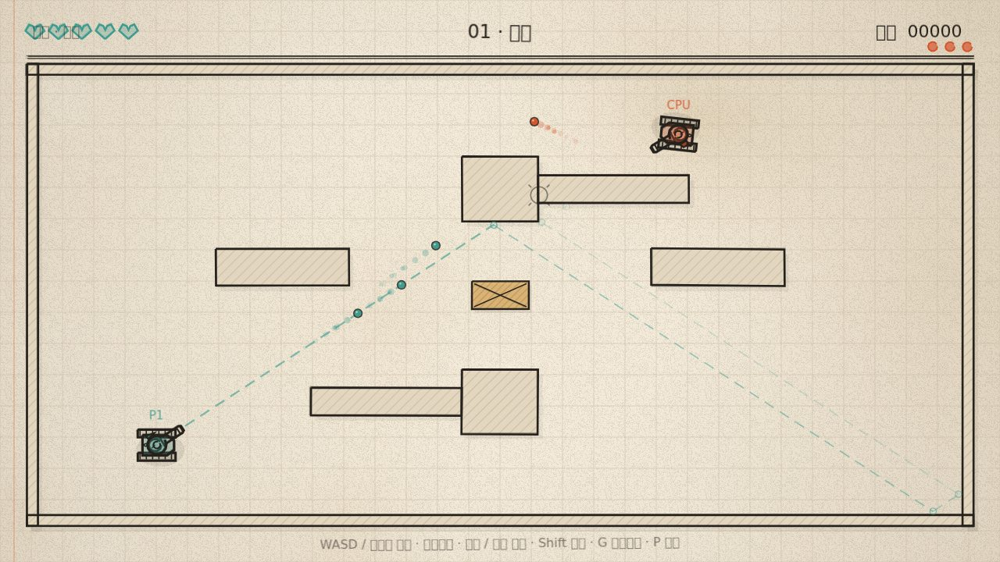
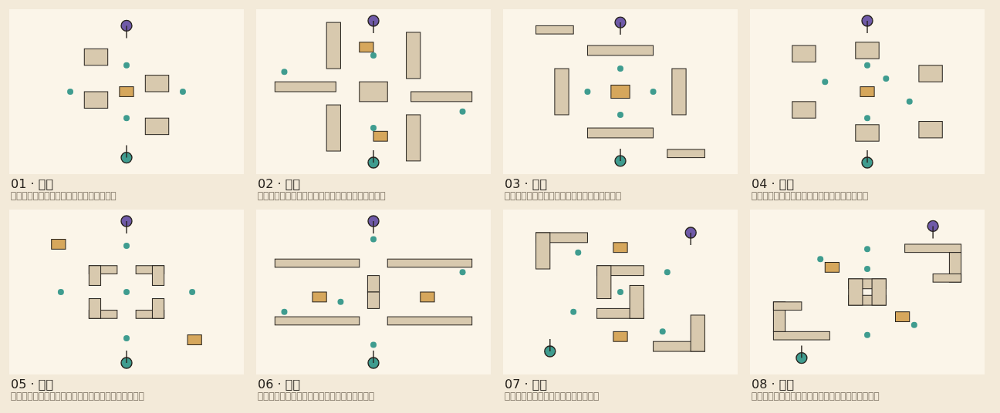
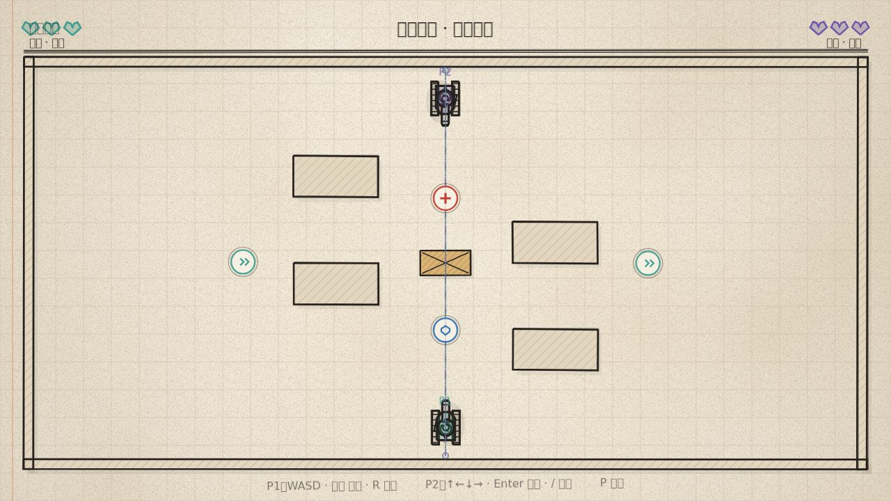

# 坦克大作战 · Sketch Tank Ricochet

一个**简笔画 / 几何风格**的坦克对战小游戏。你开着一台铅笔涂出来的小坦克，在纸上的方厅里转向、前进、开火——**子弹打到任何墙壁都会反弹，包括你自己的炮弹**（站在自己的弹道上一样会被自己打到）。

支持**单人闯关**（三档难度，AI 会打反弹球、会躲你的炮弹）、**本地双人**（同一台电脑，两人对轰）和**局域网联机**（同一个 Wi-Fi 里 **2–10 人**同时对打，不用联网、不用注册、不用服务器）。地图有 **11 张**可选（多人图比屏幕更大，镜头跟着你走），地上散落着**碰到就吃、躲不掉的道具**，开局前还能给每一边挑一个**召唤师技能**（闪现 / 无敌 / 狂暴 / 弱化）。还有一个**自动躲弹**模式：车身自己躲炮弹，你只管瞄准和开火。

用主流游戏引擎 **[Phaser 3](https://phaser.io/)**（3.90）构建，Vite + TypeScript 打包，`npm run dev` 即可开玩。



  

## 三种打开方式

### 1. 什么都不装：双击一个文件

[`TankGame-1.2.0-portable.html`](https://github.com/Adamisatree/TankGame/releases/download/v1.2.0/TankGame-1.2.0-portable.html)是一个**完全自包含**的网页（1.5 MB，脚本、样式、素材全在里面，没有任何外部依赖）。

- Windows / macOS / Linux：双击它，用浏览器打开就能玩**单人闯关**和**本地双人**；
- 想发给朋友，直接把这一个文件发过去即可，不需要联网、不需要装任何东西。

> 局域网联机需要下面两种方式之一（浏览器不能当服务器用）。

### 2. 联机客户端：.exe / .dmg（推荐）

从 [Releases](https://github.com/Adamisatree/TankGame/releases/latest) 下载对应安装包：

| 你的电脑 | 下载 |
| --- | --- |
| Windows（省心版：x64 与 arm64 合成一个安装包） | [TankGame-1.2.0-setup.exe](https://github.com/Adamisatree/TankGame/releases/download/v1.2.0/TankGame-1.2.0-setup.exe) |
| Windows（Intel / AMD，单架构更小） | [TankGame-1.2.0-x64-setup.exe](https://github.com/Adamisatree/TankGame/releases/download/v1.2.0/TankGame-1.2.0-x64-setup.exe) |
| Windows（ARM 笔记本，单架构更小） | [TankGame-1.2.0-arm64-setup.exe](https://github.com/Adamisatree/TankGame/releases/download/v1.2.0/TankGame-1.2.0-arm64-setup.exe) |
| Windows 免安装（解压即用） | [TankGame-1.2.0-portable.exe](https://github.com/Adamisatree/TankGame/releases/download/v1.2.0/TankGame-1.2.0-portable.exe) |
| Mac（M1/M2/M3/M4，`.app` 打包） | [TankGame-1.2.0-arm64.dmg](https://github.com/Adamisatree/TankGame/releases/download/v1.2.0/TankGame-1.2.0-arm64.dmg) |
| Mac（Intel） | [TankGame-1.2.0-x64.dmg](https://github.com/Adamisatree/TankGame/releases/download/v1.2.0/TankGame-1.2.0-x64.dmg) |

装好之后桌面上就有「坦克大作战」图标，**双击即玩**：客户端自己会起局域网服务，切到「局域网联机」直接建房/加入，不需要命令行、不需要 npm。

> 安装包没有做代码签名（个人项目拿不到证书），所以：
> - Windows：首次运行 SmartScreen 会拦一下 → 点「更多信息」→「仍要运行」；
> - macOS：首次打开提示「无法验证开发者」→ 右键点图标选「打开」，或执行 `xattr -dr com.apple.quarantine /Applications/TankGame.app`。

### 3. 开发模式

```bash
npm install
npm run dev        # http://localhost:5173
```

其他命令：

```bash
npm run build        # 类型检查 + 生产构建（输出到 dist/）
npm run lan          # 构建并启动局域网服务：http://<你的IP>:8787
npm run build:single # 生成 release/坦克大作战.html 单文件版
npm run test:desktop # 检查桌面端打包后能否正常起服务
npm run test:update  # 更新 / 换版本 / 镜像回退逻辑的检查
```

## 自动更新、换版本、镜像下载

菜单最下面有一个 **「更新与版本」** 折叠面板（标题右边一直显示当前版本，比如 `v1.2.0`）：

- **检查更新**：同时向 jsDelivr CDN、几个 GitHub 加速站和 GitHub 官方 API 发请求，**谁先回谁用**，再等一下下取其中最新的一份——所以既快又不会拿到过期的缓存；
- **任意版本号都能装**：列表里每个版本都有「下载并安装」，往上装是升级，**往下装就是降级**（想回到上个版本玩，选旧版本装回去即可）；
- **下载全走镜像**：`ghfast.top`、`gh-proxy.com`、`ghproxy.net`、`gh.llkk.cc` 等前缀镜像一个个自动重试，镜像全挂了才回落到 github.com；镜像列表在仓库根目录的 `mirrors.json` 里，改一个文件就能加新的；
- **本地留档**：下载好的安装包存在用户目录的 `versions/` 里，面板下方会列出「本机已下载的版本」，再切回旧版本不用重新下载；同一版本重复点击也只会校验一下缓存；
- **下载校验**：边下边算 SHA-256，和 `updates.json` 里 GitHub 记录的摘要比对，校验不过或者被代理截断就自动换下一条线路，装上去的一定是完整的那一份；
- **镜像测速 + 手动选线**：`镜像测速` 会并发量每个站点的延迟并标出最快的一条（★），也可以在下拉框里固定用某一条；
- 浏览器/单文件版里没有「安装」权限，按钮会变成镜像直链下载，其余逻辑一样。

> 装回旧版本时，Windows 安装器会直接覆盖安装（NSIS 不做版本高低检查）；macOS 打开旧版 dmg 拖进 Applications 覆盖即可。

### 发布新版本时镜像怎么保持新鲜

`updates.json`（版本清单）在 **CI 发布完成后自动重新生成**并提交回 `main`、同时挂到该 release 上；客户端优先读 CDN 上的这一份，因此**镜像挂了不影响更新，镜像源也不会把新版本挡住**。自己手动刷新：

```bash
gh api "repos/Adamisatree/TankGame/releases?per_page=30" > /tmp/releases.json
node scripts/gen-update-manifest.mjs /tmp/releases.json   # 或直接 node scripts/gen-update-manifest.mjs（需要 GITHUB_TOKEN）
```

## 局域网联机（不用联网）

### 房主：不用查自己的 IP

1. 模式选「局域网联机」→ 角色「创建房间（房主）」→ **开始游戏**；
2. 菜单里会直接列出 **你的房间地址**（`http://192.168.x.x:8787` 这种，可能有多个网卡就列出几条），点一下就复制；
3. 进入对局后，画面顶部也会一直显示 `房间 192.168.x.x:8787`；
4. 把这个地址发给朋友（微信/QQ 都行）就行——**你不用去系统设置里找 IP**。

### 访客：三种都不用记 IP 的方式

1. **直接打开房主给的网址**（浏览器输入 `http://192.168.x.x:8787`）→ 页面就是游戏，进「局域网联机 → 加入房间」→ 地址栏留空即可；
2. **客户端里自动扫描**：客户端启动时会在局域网里广播自己的房间，「加入房间」→ 点「扫描局域网房间」→ 列表里点一下房主的机器就填好了；
3. **手动填**：只填 IP（端口默认 `8787`，会自动补），或者直接粘贴整条网址。

输入框做了处理：**中文输入法打出来的「192。168。1。10」会自动变成「192.168.1.10」**，全角数字也会转成半角，粘贴整句话只会保留地址部分——之前那种「打不出点」的问题不会再出现。

**两边版本必须一致**：客人点「加入房间」时会带上自己的版本号，房主发现对不上就直接拒绝，并弹出「版本不一致：房主 v1.2.0 / 你 v1.1.0，请更新到同一版本」，不会出现打一半不同步的情况。菜单里的「更新与版本」面板可以一键装到房主的那个版本（降级也行）。

技术上是**房主权威**：房主的机器跑物理、算道具、判命中，每秒 30 次把状态推给对方，对方只上传操作意图。所以两边看到的结果一定一致，也不怕对方改内存。

- 一台电脑能同时开两个窗口做本地测试（一个当房主、一个当房客）；
- 端口默认 `8787`，被占用会自动顺延；
- 防火墙第一次会弹窗问，允许「专用网络」即可。

## 模式

开局菜单里可以自由切换，随时改随时生效：

| 模式 | 说明 |
| --- | --- |
| **单人闯关** | 你 vs AI，3 张地图。难度分「轻松 / 标准 / 困难」 |
| **本地双人** | P1 vs P2，同一台电脑，各 100 血，打完血条就分出胜负 |
| **局域网联机** | 2–10 人，乱斗或分队，各自 100 血，房主当裁判（权威同步） |

三种模式都用**血量**，不再有命数：部位伤害车尾 12 / 侧面 9 / 正面 7，子弹最多反弹 2 次。开局前的规则面板可以调乱斗/分队、人数（2/3/4/5/6/8/10）、人头目标、时间上限，以及**友伤**和**自伤**两个独立开关。

### 难度（单人）

| 难度 | 你的命 | AI 开火间隔 | AI 反弹次数 | AI 躲弹 |
| --- | --- | --- | --- | --- |
| 轻松（默认） | 5 | 3.6s | 1 | 偶尔躲 |
| 标准 | 4 | 2.6s | 2 | 会躲 |
| 困难 | 3 | 1.9s | 3 | 很会躲 |

> 第一版太难了，所以默认改成「轻松」：命更多、AI 更慢、出手更慢，而且 AI 的炮弹（500px/s）明显比你慢（830px/s）。

### 自动躲弹（单人）

菜单里打开，或游戏中按 <kbd>G</kbd> 随时切换。开启后**车体会自己躲避所有飞来的炮弹**（包括会反弹回来的），自动贴墙、找安全角度；你只负责用鼠标瞄准 + 开火。按一下 WASD 会立刻接管手动驾驶，松手后自动躲弹恢复。

## 怎么玩

| 操作 | 默认键 |
| --- | --- |
| 前进 / 后退 | `W` `S` |
| 转向（炮口跟着车体一起转） | `A` `D` |
| 炮口微调（相对车头 ±72°） | `Q` `E` |
| 瞄准 | 鼠标（单人/联机）· 双人用 `Q`/`E` |
| 开火 | 鼠标左键 / `空格` |
| 慢速微调 | `Shift` |
| 召唤师技能 | `F`（单人/联机）· 双人 P1 `R`、P2 `/` |
| 暂停 / 静音 | `P`（或 `Esc`）/ `M` |
| 自动躲弹开关（单人） | `G` |

双人模式默认键位：

| | P1（青绿） | P2（紫） |
| --- | --- | --- |
| 驾驶 / 转向 | `W` `A` `S` `D` | `↑` `←` `↓` `→` |
| 微调炮口 | `Q` / `E` | `,` / `.` |
| 开火 | `空格` | `Enter` |
| 技能 | `R` | `/` |

### 键位可以随便改（不用打字）

菜单下面「按键设置」→ 点一下那个键位按钮 → **直接按你想用的键**就设好了，`Esc` 取消。

- **每个模式各有一套键位**：单人闯关、双人 P1、双人 P2、联机房主、联机访客，互不干扰；
- 右上还有一套「系统」键（暂停 / 静音 / 自动躲弹）；
- 存在浏览器本地（`localStorage`），下次打开还在；「恢复默认」一键还原；
- 改完从下一局开始生效，游戏底部的操作提示会跟着变。

## 道具（碰到就吃，躲不掉）

地图上固定几个点会刷道具，**坦克一碰到立刻生效，没有确认、也没法拒绝**——所以走位时要把它当障碍物算进去。吃掉后 12 秒在原地重新刷一个（种类随机）。

| 图标 | 道具 | 效果 |
| --- | --- | --- |
| ➕ | 医疗包 | 立刻回 1 条命（不超过上限），最常见的道具 |
| » | 加速 | 8 秒内移速 +40% |
| ⬡ | 护盾 | 6 秒内免疫伤害（打上去只有一圈护盾波纹） |

## 召唤师技能（开局前选）

单人/双人/联机在开始前各选一个，对局中按技能键释放，冷却好了 HUD 会显示「就绪」。

| 技能 | 效果 | 冷却 |
| --- | --- | --- |
| 闪现 | 朝炮口方向瞬移最多 170px（前面有墙会缩短距离），落地带 **0.5 秒无敌** | 8s |
| 无敌 | 3.5 秒免疫所有伤害 | 18s |
| 狂暴 | 8 秒移速 +30%，接下来 5 发炮弹伤害翻倍（弹丸更大更红） | 16s |
| 弱化 | 让对手 6 秒移速 -40% | 14s |

联机时每个人的选择都会同步：房主在菜单里选自己的，访客选自己的，配对时互相告诉对方，房间右上角的**公示区**同时列出每个座位的队别、技能和人头数——所有人看到的都一样。

### 炮管会过热（只有你自己看得见）

连续开火会攒**热量**：每发 +26，平时每秒散 9，打满 100 就锁死炮管，必须等它降到 30 才能再打（约 1.6 秒，过热时每秒散 45）。**没打满之前开火完全不受限**，点射永远打得出去；这条热量条和倒计时只画在**你自己**的屏幕上，对手看不到——他们只会看到你突然哑火。

## 大地图与镜头

多人图（`yard` 1800×1200 / `depot` 2400×1600 / `field` 3200×2200）比窗口大，镜头平滑跟着你自己的坦克走，HUD 钉在屏幕上不跟着飘；没有战争迷雾，也没有小地图，靠的就是**视野变小、车相对地图变小**。

## 地图



8 张图，全部是 **0～1 归一化坐标 + 180° 中心对称**：只要写一半，另一半自动镜像出来，保证两个人分到的地形完全一样。

| # | 地图 | 特点 |
| --- | --- | --- |
| 01 | 方厅 | 最基础，四个方块柱子围出中庭 |
| 02 | 回廊 | 纵向长廊切三条道，贴墙反弹最难防 |
| 03 | 交叉 | 四条短墙围成十字，中间木箱能挡炮 |
| 04 | 柱廊 | 六根石柱，绕柱子开枪容易反弹回自己 |
| 05 | 回字 | 中央一圈墙四门洞开，抢中间道具会被夹 |
| 06 | 夹道 | 两道长墙卡中路，只能从两侧缝里钻 |
| 07 | 对角 | 阶梯状折墙，斜着跑一路蹭反弹 |
| 08 | 双城 | 对角两座小要塞，出门就开阔 |

菜单里点缩略图就能换（缩略图就是用同一份地图数据画出来的，所见即所得），也可以选「随机」。

单人模式从你选的那张图开始，一路往下连打 5 关。

### 想加地图？

在 `src/engine/level.ts` 的 `LEVELS` 里加一条就行：

```ts
{
  id: 'my-map',
  name: '09 · 你的图',
  blurb: '一句话描述',
  tags: ['pillars'],
  walls: sym(box(0.3, 0.2, 0.1, 0.1), box(0.2, 0.3, 0.1, 0.1)), // 写一半，自动镜像
  crates: [box(0.47, 0.47, 0.06, 0.06)],
  pickups: [{ x: 0.5, y: 0.35 }, { x: 0.5, y: 0.65 }, { x: 0.3, y: 0.5 }],
  player: { x: 0.5, y: 0.9, angle: -Math.PI / 2 },
  enemy: { x: 0.5, y: 0.1, angle: Math.PI / 2 },
  enemyGrace: 2.4,
  enemyReload: 1.9,
}
```

`npm run selftest` 会自动跑 `validateLevels()`：越界、出生点贴墙、**出生点前方没有开炮空间**、道具/木箱卡在墙里、对称性、id 重复……任何一项不合格都会直接报错，所以坏地图进不了包。`npm run maps` 会把所有地图画成一张 PNG（`docs/maps.png`）方便肉眼检查。



> 绿色 / 紫色虚线分别是 P1 / P2 的真实反弹路径（拐角上的小圈就是反弹点）。双人模式两人共用一块键盘，各自有独立的瞄准线与生命值。

## 你会看到什么

- **手绘画风**：所有墙、坦克、准星、准星虚线和 HUD 都由 `Sketch` 绘制——同一条路径重复描 2～3 遍，并叠加低频抖动，看起来像铅笔描了两次；线条还会以 8fps 轻微“呼吸”。纸纹、纤维、暗角在运行时用 Canvas 生成，项目里没有任何图片素材。
- **战术慢速**：按住右键/Shift，车体会慢下来，方便贴着墙找反弹角度。
- **AI 银行射术**：敌人开火前会做反弹射线搜索，找一条能穿过你的路径（困难难度还会预判你的走位提前量）；开火前用虚线预告，给你反应时间。
- **AI 会躲你的炮弹**：它每 0.12～0.3 秒评估一次“我这块地方危不危险”，会横移、后退、贴墙绕开你自己的反弹线。
- **自动躲弹**：同一套躲弹算法也给你用——开启后车身自己走位。
- **反馈**：命中闪白、镜头震动、铅笔屑粒子、弹壳拖尾、合成音效（WebAudio 现场合成，无音频文件）。

## 技术要点

### 1. 反弹不用物理引擎，而是解析求交

坦克和墙壁的判定是「圆 vs AABB」，炮弹用**扫掠**求交，而不是逐帧采样位置：

- `circleBox` —— 圆与矩形精确相交 + 推出向量，用来把坦克从墙里挤出来；
- `rayBox` —— slab 法，返回进入/离开两个面及各自法线（射线起点在扩展盒内部时，接触面是“离开面”，这正是刚反弹完一帧会踩到的坑）；
- `sweepCircleBox` —— 把墙按半径扩张成 AABB 再做 slab 求交，得到**第一个接触点、法线与剩余行程**，所以 2000px/s 的炮弹也不会穿墙；
- `reflect` —— 沿法线反射速度，墙面还可带 `bounce` 阻尼。

`advanceBullet()` 在剩余时间预算内循环处理“撞墙 → 反射 → 继续飞”，并在同一段上按距离排序墙、木箱、敌方坦克三种接触，命中谁就是谁。

### 2. 敌人怎么“算”反弹

`planRicochetShot()`：以 64 个方向为初值做粗扫，对每个方向模拟最多 3 次反弹并记录与玩家的最近距离（`closestOnSegment`）；随后在最优方向附近做 4 轮二分细化，最终只接受最近距离小于坦克命中半径的解。这样它能打出真正会命中的**银行球**，而不是乱射。

### 3. 炮口装在车体上

炮塔不再是「独立悬浮」的：`turretAngle = bodyAngle + turretOffset`，转向时车体和炮管一起转，`aimAt()` 把 `turretOffset` 夹在 ±72°，所以只能相对车头微调，不能转身就打身后。网络快照只传 `body` 和 `turret`，客机 `syncTurret()` 反推出偏移量，两边表现一致。AI 也一样：目标跑到射界外时它会先转车体。

### 4. 贴墙开炮不会穿墙

旧版把炮口直接放在 `半径 + 枪管长` 的位置，枪管插进墙里时炮弹就生成在墙的另一侧。现在开炮前用 `sweepCircleBox` 沿炮口方向量出**第一个实心表面**（墙和木箱都算），把炮口夹在它前面；实在贴得太死就只"咔"一声，不生成幽灵炮弹。`selftest` 的 `validateLevels()` 还会检查出生点正前方有没有开炮空间。

### 5. 结构

```
src/
  engine/            # 纯逻辑，零 Phaser 依赖（可直接在 Node 里测）
    physics.ts       # 圆/AABB、slab、扫掠、反射
    bullet.ts        # 炮弹推进与接触事件
    ai.ts            # 反弹瞄准求解、线段/圆相交
    steer.ts         # 躲弹：炮弹轨迹预测 + 候选方向评分 + 坦克转向控制
    level.ts         # 关卡数据（归一化坐标 → 自适应投影）
  game/
    GameScene.ts     # 战斗循环、双人/单人模式、AI 行为、特效、HUD
    settings.ts      # 模式 / 难度预设 / 自动躲弹开关
    MenuScene.ts     # 标题页背景动画
    Tank.ts          # 坦克手绘贴图（车体 + 炮塔两层）
    Sketch.ts        # 手绘绘图工具（描边、抖动、排线、纸张质感）
    art.ts           # 运行时生成纸纹/颗粒纹理
    Sound.ts         # WebAudio 合成音效
  main.ts            # Phaser 启动 + DOM 覆盖层（开始 / 暂停 / 结束）
  net/
    protocol.ts      # 局域网报文格式（快照 / 输入 / 事件）
    LanClient.ts     # WebSocket 客户端（自动重连、状态回调）
  update/
    UpdaterPanel.ts  # 菜单里的「更新与版本」面板（检查 / 换版本 / 镜像 / 进度）
    types.ts         # preload 暴露的更新接口类型
  version.ts         # 构建时注入的版本号（__APP_VERSION__）
  game/
    pickups.ts       # 三种地图道具的数据与抽取权重
    skills.ts        # 四个召唤师技能的数据（冷却 / 时长）
    keybinds.ts      # 按键绑定：默认值、校验、存档、按键名字
shared/
  update-core.mjs    # 纯逻辑：版本比较、安装包识别、镜像 URL、清单归一化
  fetch-manifest.mjs # 并发拉清单、取最新的一份（不被慢镜像拖住）
  download.mjs       # 镜像逐个重试下载 + SHA-256 校验 + 截断检测
server/
  lan-server.mjs     # 静态站点 + WebSocket 中继（一个进程，无外部服务）
electron/
  main.cjs           # 桌面窗口，启动时自带局域网服务
  lan-boot.cjs       # 服务引导（可脱离 Electron 单独测试）
  discovery.cjs      # UDP 广播/扫描：访客一键找到房间
  updater.cjs        # 更新：设置存档、拉清单、测速、下载校验、启动安装器
  preload.cjs        # 只暴露「扫描局域网 / 更新」这两个能力
scripts/
  selftest.ts        # 157 项纯逻辑检查（含地图校验、道具、技能、键位、炮管过热）
  updatetest.ts      # 77 项更新检查（版本比较、换版本、镜像回退、校验、清单并发）
  smoke.ts           # jsdom + 软件 Canvas 里跑真游戏的冒烟测试（48 项，含真 WebSocket 联机）
  multitest.ts       # 22 项多人房间检查（2–10 人、分队、容量、版本拦截）
  lantest.ts         # 30 项局域网中继检查（配对 / 转发 / 断线 / 重开 / 版本拦截）
  desktop-test.ts    # 7 项打包后服务检查
  verify-singlefile.ts # 在 jsdom 里真的打开单文件版，确认能起（26 项，含版本号与更新面板）
  gen-update-manifest.mjs # 从 GitHub Releases 生成 updates.json
  map-sheet.ts       # 把 8 张地图画成一张总览图（docs/maps.png）
  render.ts          # 离线渲染 PNG 截图（npx tsx scripts/render.ts 输出目录）
```

渲染分辨率固定 1280×720，`Phaser.Scale.FIT` 等比缩放适配任意窗口。

## 可调参数

`src/game/config.ts`：

- `TANK.driveSpeed` / `turnRate` —— 手感；
- `BULLET.speedPlayer` / `speedEnemy` / `maxBounces` / `lifetime` —— 弹速与弹跳上限；
- `COLORS` —— 纸、墨、我方青绿、敌方砖红。

`src/engine/level.ts` 里三个关卡都是 0～1 归一化坐标，加一个 `LEVELS` 条目就能加关；`enemyGrace`（开局呼吸时间）和 `enemyReload`（开火间隔）控制难度。

## 后续可以做的

- 手机端虚拟摇杆（目前建议键盘）；
- 更多模式：时间赛、占点、道具；
- 多敌人 / 波次、道具、可破坏墙；
- 关卡编辑器与最佳成绩本地存档；
- 增量更新（目前每个版本都是整包下载）；
- 更精细的笔触（同一笔画内变宽、墨点堆积）。
