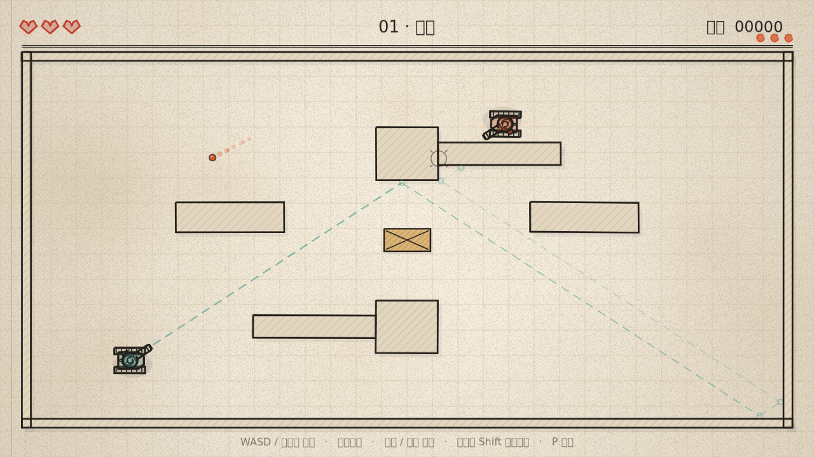

# 坦克大作战 · Sketch Tank Ricochet

一个**简笔画 / 几何风格**的坦克对战小游戏。你开着一台铅笔涂出来的小坦克，在纸上的方厅里转向、前进、开火——**子弹打到任何墙壁都会反弹**，一共 3 条命，被击中 3 次就结束。

用主流游戏引擎 **[Phaser 3](https://phaser.io/)**（3.90）构建，Vite + TypeScript 打包，`npm run dev` 即可开玩。


  

## 快速开始

```bash
npm install
npm run dev        # http://localhost:5173
```

其他命令：

```bash
npm run build      # 类型检查 + 生产构建（输出到 dist/）
npm run preview    # 预览生产构建（http://localhost:4173）
npm run selftest   # 无头运行物理 / 反弹 / 命中判定的单元测试
```

## 怎么玩

| 操作 | 键位 |
| --- | --- |
| 前进 / 后退 | `W` `S` 或 `↑` `↓` |
| 转向（原地也可转） | `A` `D` 或 `←` `→` |
| 炮塔瞄准 | 鼠标 |
| 开火 | 鼠标左键 / `空格`（可按住连发） |
| 慢速微调（精细走位） | 鼠标右键 / `Shift` |
| 暂停 | `P` / `Esc` |
| 静音 | `M` |

规则：

- 敌方坦克要 **命中 3 次**才会被击毁，你也有 **3 条命**（左上角的心）。
- 你的炮弹最多反弹 **4 次**，敌方炮弹 4 次；反弹次数用尽后炮弹会自动消失。
- 木箱会**挡住**炮弹（打碎它 +25 分）同时也挡住坦克。
- 干掉敌人 +1000 分，命中 +150 分。共 3 关，全清即通关。
- 瞄准时那条**虚线就是真实的反弹路径**（含反弹点标记），照着它打就行。



> 上面这张绿色虚线就是真实的反弹路径（拐角处的小圆圈是反弹点），照着它打就能用墙“拐弯”命中。

## 你会看到什么

- **手绘画风**：所有墙、坦克、准星、准星虚线和 HUD 都由 `Sketch` 绘制——同一条路径重复描 2～3 遍，并叠加低频抖动，看起来像铅笔描了两次；线条还会以 8fps 轻微“呼吸”。纸纹、纤维、暗角在运行时用 Canvas 生成，项目里没有任何图片素材。
- **战术慢速**：按住右键/Shift，车体会慢下来，方便贴着墙找反弹角度。
- **敌方银行射术**：敌人每轮开火前会做一次反弹射线搜索，找到一条能穿过你的路径；开火前 0.55 秒用虚线给出预告（Reddit 式的“公平预警”）。找不到路径时它就朝你直射，靠运气弹。
- **反馈**：命中闪白、镜头震动、铅笔屑粒子、弹壳拖尾、合成音效（WebAudio 现场合成，无音频文件）。

## 技术要点

### 1. 反弹不用物理引擎，而是解析求交

坦克和墙壁的判定是「圆 vs AABB」，炮弹用**扫掠**求交，而不是逐帧采样位置：

- `circleBox` —— 圆与矩形精确相交 + 推出向量，用来把坦克从墙里挤出来；
- `rayBox` —— slab 法，返回进入/离开两个面及各自法线（射线起点在扩展盒内部时，接触面是“离开面”，这正是刚反弹完一帧会踩到的坑）；
- `sweepCircleBox` —— 把墙按半径扩张成 AABB 再做 slab 求交，得到**第一个接触点、法线与剩余行程**，所以 2000px/s 的炮弹也不会穿墙；
- `reflect` —— 沿法线反射速度，墙面还可带 `bounce` 阻尼。

`advanceBullet()` 在剩余时间预算内循环处理“撞墙 → 反射 → 继续飞”，并在同一段上按距离排序墙、木箱、敌方坦克三种接触，命中谁就是谁。

### 2. 敌人怎么“算”反弹

`planRicochetShot()`：以 64 个方向为初值做粗扫，对每个方向模拟最多 3 次反弹并记录与玩家的最近距离（`closestOnSegment`）；随后在最优方向附近做 4 轮二分细化，最终只接受最近距离小于坦克命中半径的解。这样它能打出真正会命中的**银行球**，而不是乱射。

### 3. 结构

```
src/
  engine/            # 纯逻辑，零 Phaser 依赖（可直接在 Node 里测）
    physics.ts       # 圆/AABB、slab、扫掠、反射
    bullet.ts        # 炮弹推进与接触事件
    ai.ts            # 反弹瞄准求解、线段/圆相交
    level.ts         # 关卡数据（归一化坐标 → 自适应投影）
  game/
    GameScene.ts     # 战斗循环、AI 行为、特效、HUD
    MenuScene.ts     # 标题页背景动画
    Tank.ts          # 坦克手绘贴图（车体 + 炮塔两层）
    Sketch.ts        # 手绘绘图工具（描边、抖动、排线、纸张质感）
    art.ts           # 运行时生成纸纹/颗粒纹理
    Sound.ts         # WebAudio 合成音效
  main.ts            # Phaser 启动 + DOM 覆盖层（开始 / 暂停 / 结束）
scripts/
  selftest.ts        # 39 项纯逻辑检查
  smoke.ts           # jsdom + 软件 Canvas 里跑真游戏的冒烟测试
  render.ts          # 离线渲染 PNG 截图（npx tsx scripts/render.ts 输出目录）
```

渲染分辨率固定 1280×720，`Phaser.Scale.FIT` 等比缩放适配任意窗口。

## 可调参数

`src/game/config.ts`：

- `TANK.driveSpeed` / `turnRate` —— 手感；
- `BULLET.speedPlayer` / `speedEnemy` / `maxBounces` / `lifetime` —— 弹速与弹跳上限；
- `COLORS` —— 纸、墨、我方青绿、敌方砖红。

`src/engine/level.ts` 里三个关卡都是 0～1 归一化坐标，加一个 `LEVELS` 条目就能加关；`enemyGrace`（开局呼吸时间）和 `enemyReload`（开火间隔）控制难度。

## 后续可以做的

- 手机端虚拟摇杆（目前建议键盘）；
- 多敌人 / 波次、道具、可破坏墙；
- 关卡编辑器与最佳成绩本地存档；
- 更精细的笔触（同一笔画内变宽、墨点堆积）。
